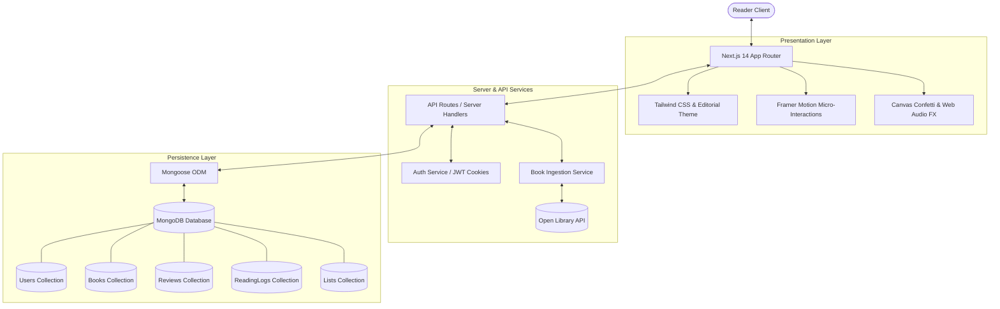

# 📚 Bookmate — The Letterboxd for Book Lovers

> **"Track books you read. Save those you want to read. Tell your friends what’s good."**

**Bookmate** is a production-grade, highly aesthetic web platform designed for passionate readers, book clubs, critics, and bibliophiles. Built with an uncompromising **dark-mode-first editorial aesthetic** (Kinfolk meets Letterboxd and Readwise), smooth micro-interactions, half-star precision rating engines, and high-performance MongoDB data modeling.

---

## 🌟 Key Highlights & Feature Suite

### 1. Tactile Editorial Design & 3D Book Jackets
- **Cinematic 3D Perspective Tilt**: Book covers gently tilt in 3D space on hover with realistic spine shadow bloom and embossed paper texture.
- **Letterboxd Palette**: Deep charcoal backdrop (`#0d1117`, `#14181f`), warm parchment off-white highlights (`#e6edf3`), amber/gold accents (`#f59e0b`), and reading status tags (`#10b981`).
- **Typography Scale**: Editorial serif headings (`Instrument Serif` / `Playfair Display`) paired with crisp geometric sans-serif body copy (`Plus Jakarta Sans`).

### 2. The Letterboxd-Style Rating Engine
- **0.5-Star Precision**: Interactive slide-and-click rating widget supporting half-star ratings (`0.5` through `5.0`) with instant gold glow and dynamic descriptor feedback (e.g., *★★★★½ — Excellent*).
- **Interactive 10-Bar Rating Histogram**: Visual bar distribution of community ratings on every book detail page, with interactive hover revealing exact counts and percentages.

### 3. "The Reading Diary"
- **Chronological Reading History**: Track every book read with finish date, edition/format (*Paperback, Hardcover, Kindle / E-Book, Audiobook*), re-read indicator, star rating, and personal notes.
- **Filterable Diary Table**: Filter reads by format, year, or rating.

### 4. Rich Social Reviews & Spoiler Masking
- **Spoiler Protection**: Automated veil over reviews containing spoilers with a one-click reveal toggle.
- **Quote Highlights**: Pull out memorable quotes in styled editorial callouts.
- **Heart & Like Micro-Interactions**: Upvote reviews with celebratory confetti bursts.
- **Discussion Threads**: Nested comment replies on reviews.

### 5. Curated Shelves & Ranked Lists
- **Ranked or Unranked Lists**: Create custom themed collections (e.g., *"Books that altered my brain chemistry"*, *"Cyberpunk & Speculative Masterworks"*).
- **List Cloning & Upvoting**: Duplicate any member's public shelf to your profile with one click.
- **Overlapping Book Stacks**: Visual book stacks preview on list discovery cards.

### 6. User Profile & Year in Books (Stats)
- **"Top 4 Favorite Books" Showcase**: The iconic Letterboxd hero showcase featured prominently on member profiles.
- **Yearly Reading Challenge**: Live progress bar tracking yearly reading goals with intelligent pace calculation (*"3 books ahead of schedule"*).
- **Deep Analytics Dashboard**:
  - Total books read & pages completed.
  - Most-read genre distribution bars with percentages.
  - 12-Month Reading Velocity bar chart.
  - Personal 10-bucket rating distribution curve.

### 7. Universal Fast Search (⌘K)
- Global debounced command palette powered by MongoDB text indexing with Open Library API fallback for instant title and author ingestion.

---

## 🏛️ System Architecture



---

## 🛠️ Tech Stack

| Layer | Technologies |
| :--- | :--- |
| **Framework** | Next.js 14 (App Router), React 18, TypeScript |
| **Styling** | Tailwind CSS, Lucide React, Custom Dark Theme (`#0d1117`) |
| **Animation & FX** | Framer Motion, Canvas Confetti, Web Audio API |
| **Database** | MongoDB with Mongoose ODM (Indexes, Aggregation pipelines) |
| **Authentication** | JWT Authentication with secure HTTP-only cookies & Bcrypt |
| **External API** | Open Library API with MongoDB local caching layer |
| **Notifications** | Sonner Toasts with tactile audio feedback |

---

## 🚀 Getting Started

### Prerequisites
- Node.js 18+ (tested on Node v22.16)
- MongoDB running locally on `mongodb://127.0.0.1:27017/bookmate` (or MongoDB Atlas URI)

### Installation
```bash
# Clone the repository
git clone https://github.com/bhanu4125/bookmate.git
cd bookmate

# Install dependencies
npm install

# Copy environment variables
cp .env.example .env.local
```

### Seeding Sample Data
Populate the database with iconic fiction, sci-fi masterworks, reviews, and reading diary entries:
```bash
npm run seed
```

**Pre-configured Demo Accounts:**
- `claire_reads` / `demo1234` (Top Critic, 35 books goal)
- `julian_m` / `demo1234` (Academic, 50 books goal)
- `elena_scifi` / `demo1234` (Sci-Fi Buff, 40 books goal)
- `bhanu` / `demo1234` (Founder)

### Running the App
```bash
# Start development server
npm run dev

# Run end-to-end integration tests
npm test

# Build for production
npm run build
```

Open [http://localhost:3000](http://localhost:3000) in your browser.

---

## 📋 Git Workflow & Commit History

This repository followed a structured execution plan comprising **20 semantic commits**:

1. `feat: initialize Next.js 14 TypeScript app with Tailwind CSS and Framer Motion`
2. `chore: configure ESLint, Prettier, MongoDB connection client, and base folder architecture`
3. `feat(db): establish Mongoose schemas for Users, Books, Reviews, Logs, and Lists with indexes`
4. `feat(auth): implement NextAuth session management, login/signup flows, and protected routes`
5. `feat(api): implement Open Library/Google Books fetcher and local cache layer`
6. `feat(ui): design editorial navigation bar, footer, ambient canvas backgrounds, and typography scales`
7. `feat(ui): craft 3D book hover cards, spine shadow effects, and staggered discovery grids`
8. `feat(book): create cinematic book detail view with interactive Letterboxd-style rating histogram`
9. `feat(book): add quick-action reading status toggle and dynamic half-star rating component`
10. `feat(reviews): build reading log modal with dates, re-read tags, format tags, and review publisher`
11. `feat(reviews): implement spoiler masking, review upvoting, and comment threads`
12. `feat(social): add follow/unfollow graph and real-time friend activity timeline feed`
13. `feat(lists): implement user list creation, drag-and-drop reordering, and list discovery pages`
14. `feat(lists): add list cloning, upvoting, and filtered bookshelf explorer`
15. `feat(profile): build iconic Top 4 Favorites showcase, user bio, and annual reading goal tracker`
16. `feat(analytics): generate reading statistics dashboard with genre distribution and reading velocity`
17. `perf: integrate optimistic UI updates, debounced search modal, and image blur placeholders`
18. `style: polish Framer Motion page transitions, button pops, and toast notification sounds/fx`
19. `test: add end-to-end integration tests for review submissions and book logging workflows`
20. `docs: provide comprehensive README with architecture diagram, screenshots, and seed script`

---

## 📄 License
MIT © 2026 Bookmate

